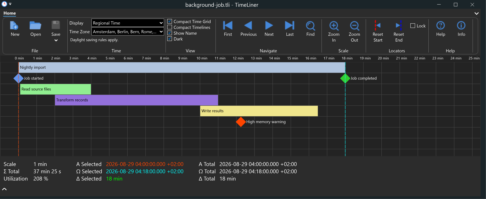

<p align="center">
  
</p>

# TimeLiner



TimeLiner is a Windows tool for visualizing time events.

I started working on TimeLiner in 2020 while analyzing software defects in my daily work.
Many of these analyses involved events from different sources, such as log files, traces,
or monitoring data, all related by time.

I looked for an existing tool that would let me draw timelines freely, place events
accurately in time, and measure distances between them. Since I could not find anything
that matched these requirements, I decided to write a small tool myself.

## Features

- Visualize time events and time spans on multiple parallel timelines
- Correlate events from logs, traces, monitoring data, and other sources on a shared time axis
- Zoom from millisecond-level detail to week-level overviews
- Find and navigate to timeline items by name
- Measure exact time points and durations using movable start and end locators
- Calculate total duration, summed item duration, and timeline utilization
- Display times in a selected Windows time zone or with a fixed UTC offset
- Use a simple CSV-based file format suitable for manual editing and automated generation

## Known limitations

- Supported zoom scales range from milliseconds to weeks. Month- and year-based
  scales are not supported because their durations are not constant and depend on
  the calendar, including leap years.
- TimeLiner may become slow when displaying large numbers of timeline items
  due to WPF rendering limitations.
- CSV field escaping is not supported.

---

## Developer Quick Start

### Prerequisites

- Windows 11 x64
- .NET 10 SDK (including the Windows Desktop SDK)
- PowerShell

### Clone the Repository

```bash
git clone https://github.com/Pizzy72/TimeLiner.git
```

### Build and Test

Restore packages, build the x64 Release configuration, and run the complete test suite:

```powershell
dotnet restore TimeLiner.sln
dotnet build TimeLiner.sln --configuration Release --property:Platform=x64
dotnet test Test/TimeLinerTest/TimeLinerTest.csproj --configuration Release --property:Platform=x64 --no-build
```

### Run

After building, TimeLiner can be started:

- from Visual Studio, or
- with `dotnet run --project Source/TimeLiner/TimeLiner.csproj --configuration Release --property:Platform=x64`, or
- directly from the generated build output by running `TimeLiner.exe`.

The application is portable. User-specific settings are stored separately under:

```
%APPDATA%\TimeLiner\
```

### Time Display

The **Time** Ribbon group offers two display modes:

- **Regional time** uses the selected Windows time zone and the summer/winter
  time rules applicable to each event's date. The selected entry shows the region.
- **Fixed UTC offset** uses one offset for every event, without daylight-saving
  adjustment. Type `+HH:mm` or `-HH:mm` (from `-14:00` to `+14:00`), or choose
  a preset. UTC is `+00:00`. Enter commits a valid edit and leaves the input field;
  leaving the field also commits an edit. Escape
  cancels it. Invalid input leaves the previous valid display unchanged.

The preset list starts with **First event** and **UTC (+00:00)**, followed by
whole-hour offsets from `-12:00` to `+14:00` in ascending order, with `+05:30` and
`+05:45` included. Other offsets remain freely editable.

The offset list also includes **First event**, showing the resolved offset. This
uses the explicit offset of the start timestamp of the first event in **file order**,
not the chronologically earliest event. It is recalculated when another file is
loaded, not when events are edited or reordered. Mixed offsets elsewhere in the
file do not change this one common display offset. If that first timestamp has no
explicit offset, or the file has no events, select an offset manually.

The `T` shortcut switches between regional time and the selected fixed offset.
Times entered in the event editor without an explicit offset use the selected
display context. In regional mode, ambiguous or nonexistent clock times around
a daylight-saving transition require correction or an explicit offset.

You can also select the display at startup:

```powershell
TimeLiner.exe data.csv -timezone "W. Europe Standard Time"
TimeLiner.exe data.csv -timezone local
TimeLiner.exe data.csv -timezone UTC
TimeLiner.exe data.csv -offset +02:00
TimeLiner.exe data.csv -offset -05:30
TimeLiner.exe data.csv -offset auto
```

Specify only one of `-timezone` and `-offset`. `-offset auto` requires a file with
an explicit offset (`Z` counts as zero) on its first event. Without either option,
the saved display setting is used. A command-line choice is reflected in the
Ribbon and can subsequently be changed there.

All modes preserve the same instants, event positions, and elapsed durations.
Saving still writes timestamps in UTC; therefore, **First event** on a saved file
resolves to `+00:00`. Display settings are stored in user settings, not in CSV files.

### Documentation

Developer-oriented documentation is located in the `doc` folder.

Start with [TimeLiner – Overview](doc/overview.md)

---

## Contributing

TimeLiner is a personal hobby project maintained in my spare time.

I am not accepting pull requests and cannot guarantee support, bug fixes, or new
features. Bug reports and suggestions may be submitted through GitHub Issues.

You are welcome to fork the project for your own development.

---

## License

SPDX-License-Identifier: MIT

Copyright (c) 2020–2026 Christian Pistor

TimeLiner is licensed under the [MIT License](LICENSE). Runtime dependencies are
restored from NuGet; their notices are recorded in
[THIRD-PARTY-NOTICES.txt](THIRD-PARTY-NOTICES.txt).

## Acknowledgements

Parts of the TimeLiner codebase, tests, and documentation were developed with
assistance from Microsoft Copilot and OpenAI Codex. All resulting changes were reviewed and integrated
by the project maintainer.
